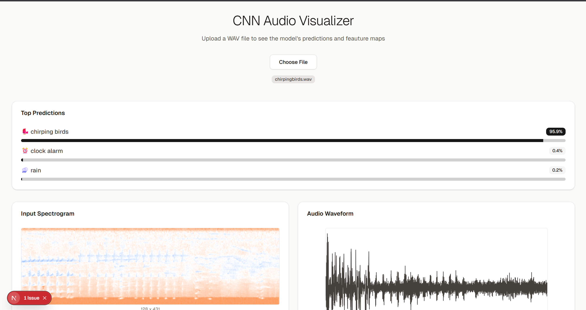
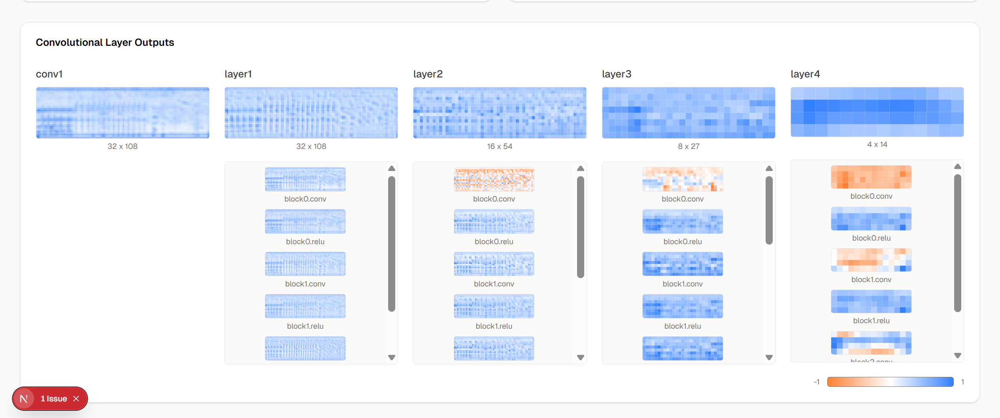
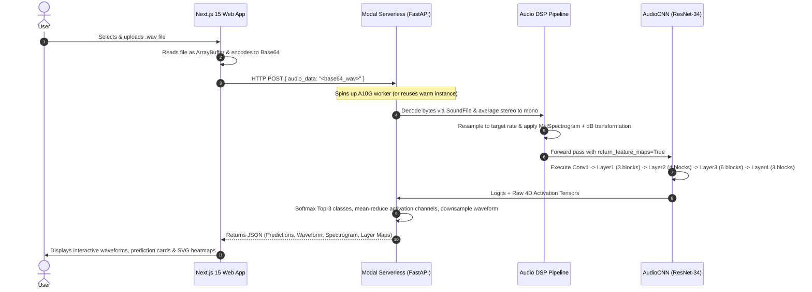

# Audio CNN Visualizer




---

# 🎵 Audio CNN Visualizer & Classifier
### *Deep Learning-Powered Environmental Sound Classification with Real-Time CNN Layer Interpretability*

[](https://www.python.org/)
[](https://pytorch.org/)
[](https://pytorch.org/audio)
[-000000?style=for-the-badge&logo=cloud&logoColor=white)](https://modal.com/)
[-black?style=for-the-badge&logo=next.js&logoColor=white)](https://nextjs.org/)
[](https://react.dev/)
[](https://tailwindcss.com/)

---


---

## 📌 Executive Summary

**Audio CNN Visualizer** is a production-grade, full-stack deep learning system designed for **Environmental Sound Classification (ESC)** and **model interpretability**. 

Unlike conventional audio classifiers that operate as opaque black boxes, this system:
1. Transcribes raw, 1D acoustic sound waves into 2D **Mel-Spectrogram** representations.
2. Classifies them across **50 distinct environmental sound categories** (animals, nature, human sounds, domestic noises, urban sounds) using a customized **ResNet-34 Convolutional Neural Network**.
3. Dynamically hooks into intermediate convolutional stages during forward inference to extract, normalize, and expose **2D activation feature maps**.
4. Delivers an interactive, high-performance web interface built with **Next.js 15, React 19, and Tailwind CSS v4**, rendering SVG audio waveforms, input spectrograms, and layer-by-layer neural activation heatmaps with confidence scoring and emoji visualization.

---

## 🏛️ High-Level Design (HLD)

### 1. System Architecture Diagram

```mermaid
flowchart TD
    subgraph Client ["Client Layer (Web Browser)"]
        UI["Next.js 15 + React 19 Frontend"]
        AudioInput["WAV Audio File Upload"]
        WaveformView["SVG Waveform Renderer"]
        SpectrogramView["Mel-Spectrogram Heatmap"]
        PredictionsCard["Top-3 Softmax Predictions"]
        FeatureMapsGrid["Layer-wise Activation Maps"]
    end

    subgraph Cloud ["Serverless Cloud Backend (Modal Labs - Nvidia A10G GPU)"]
        FastAPI["FastAPI Inference Endpoint (/inference)"]
        Base64Decoder["Base64 Audio Decoder & Buffer"]
        AudioDSP["Audio Processing Engine (Torchaudio / Librosa)"]
        Resampler["Sample Rate Normalizer (44.1kHz / 22.05kHz)"]
        MelTransform["Mel-Spectrogram Converter + Log-dB Scale"]
        CNN["AudioCNN (ResNet-34 Architecture)"]
        HookEngine["Intermediate Feature Map Aggregator"]
        PostProcessor["Downsampler & JSON Serializer"]
    end

    subgraph Storage ["Persistent Cloud Volumes"]
        ModelWeights[("/models/best_model.pth")]
        DatasetVol[("/data/ESC-50")]
        LogsVol[("/models/tensorboard_logs")]
    end

    AudioInput --> UI
    UI -->|POST JSON { audio_data: base64 }| FastAPI
    FastAPI --> Base64Decoder
    Base64Decoder --> AudioDSP
    AudioDSP --> Resampler
    Resampler --> MelTransform
    MelTransform -->|Tensor [1, 1, 128, T]| CNN
    ModelWeights -.->|Load on Container Cold-Start| CNN
    CNN --> HookEngine
    CNN -->|Softmax Logits| PostProcessor
    HookEngine -->|2D Channel-Averaged Activations| PostProcessor
    AudioDSP -->|Downsampled 8000-pt Waveform| PostProcessor
    PostProcessor -->|Structured JSON Response| UI

    UI --> WaveformView
    UI --> SpectrogramView
    UI --> PredictionsCard
    UI --> FeatureMapsGrid
```

---

### 2. End-to-End Data Flow



---

## 🧠 Deep Learning Architecture & Training Pipeline

### 1. Neural Network Architecture (`model.py`)

The classifier is built on a customized **ResNet-34** adapted specifically for single-channel acoustic time-frequency inputs:

```
Input: Mel-Spectrogram Tensor [Batch, 1, 128, Time_Frames]
 │
 ├── Conv1: Conv2d(1 -> 64, kernel=7, stride=2, padding=3) + BatchNorm2d + ReLU + MaxPool2d(3, stride=2, padding=1)
 │
 ├── Layer 1: 3 Residual Blocks (64 -> 64 channels, stride=1)
 ├── Layer 2: 4 Residual Blocks (64 -> 128 channels, stride=2 on entry)
 ├── Layer 3: 6 Residual Blocks (128 -> 256 channels, stride=2 on entry)
 ├── Layer 4: 3 Residual Blocks (256 -> 512 channels, stride=2 on entry)
 │
 ├── Adaptive Average Pooling: AdaptiveAvgPool2d((1, 1)) -> [Batch, 512, 1, 1]
 ├── Flatten: [Batch, 512]
 ├── Dropout: p=0.5 (Regularization)
 └── Linear Head: Linear(512 -> 50 classes) -> Logits
```

#### Feature Map Extraction Mechanism
Each `ResidualBlock` records intermediate pre-ReLU and post-ReLU activations. When invoked with `return_feature_maps=True`, the model intercepts:
- Initial stem features: `conv1`
- Residual block sub-stages: `layer{X}.block{Y}.conv` and `layer{X}.block{Y}.relu`
- Stage-level representations: `layer1`, `layer2`, `layer3`, `layer4`

---

### 2. Digital Signal Processing (DSP) Pipeline

1. **Acoustic Waveform Normalization**: Stereo tracks are converted to mono by averaging channels ($\text{mono} = \frac{L + R}{2}$).
2. **Resampling**: Standardized to **22,050 Hz** (or 44,100 Hz input baseline), capturing frequencies up to 11,025 Hz (Nyquist theorem), covering environmental audio dynamics.
3. **Short-Time Fourier Transform (STFT) & Mel Scaling**:
   - `n_fft = 1024` (window length)
   - `hop_length = 512` (50% overlap for continuous temporal resolution)
   - `n_mels = 128` (triangular filter banks on the non-linear human Mel pitch scale)
   - `f_min = 0 Hz`, `f_max = 11,025 Hz`
4. **Logarithmic Compression**: Transformed via `T.AmplitudeToDB()` to match the logarithmic decibel sensitivity of human hearing.

---

### 3. Training & Optimization Techniques (`train.py`)

- **Dataset**: [ESC-50 (Environmental Sound Classification)](https://github.com/karolpiczak/ESC-50) – 2,000 labeled 5-second recordings across 50 classes (40 samples per class).
- **Cross-Validation**: 5-fold evaluation protocol (Folds 1–4 for training, Fold 5 for held-out validation).
- **Data Augmentation**:
  - **SpecAugment**: Frequency masking (`freq_mask_param=30`) and Time masking (`time_mask_param=80`) applied directly on spectrograms to prevent reliance on narrow frequency bands.
  - **Mixup Augmentation**: Spectrogram pairs blended as $\tilde{x} = \lambda x_i + (1-\lambda) x_j$ with $\lambda \sim \text{Beta}(0.2, 0.2)$, paired with soft-label interpolation to prevent overfitting.
- **Optimization Strategy**:
  - **Loss**: Cross-Entropy with **Label Smoothing ($0.1$)** to avoid overconfident predictions.
  - **Optimizer**: `AdamW(lr=0.0005, weight_decay=0.01)` with decoupled L2 weight regularization.
  - **LR Scheduler**: `OneCycleLR(max_lr=0.002, epochs=100)` with a 10% warm-up phase followed by cosine annealing.
  - **Metrics Tracking**: Real-time logging of loss curves and validation accuracy to **TensorBoard**.

---

## 💻 Tech Stack & Component Breakdown

| Layer | Technology | Version | Purpose & Rationale |
| :--- | :--- | :--- | :--- |
| **Deep Learning** | **PyTorch** | `2.x` | Core tensor computation, autograd, and neural network modeling. |
| **Audio DSP** | **Torchaudio** | `2.x` | GPU-accelerated MelSpectrogram and AmplitudeToDB transforms. |
| **Signal Processing** | **Librosa & SoundFile** | Latest | Audio decoding, stereo-to-mono reduction, and dynamic resampling. |
| **Serverless Compute**| **Modal Labs** | Latest | Serverless Python deployment on Nvidia A10G GPUs with auto-scaling. |
| **API Framework** | **FastAPI** | Latest | High-throughput asynchronous REST endpoint mounted via Modal. |
| **Frontend Core** | **Next.js** | `15.2.3` | App Router, SSR, Turbopack, and optimized client bundle. |
| **UI Library** | **React** | `19.0.0` | Declarative UI state management and reactive SVG rendering. |
| **Styling** | **Tailwind CSS** | `v4.0` | Modern OKLCH color spaces, utility classes, and responsive grids. |
| **Components** | **Radix UI** | Latest | Accessible headless components (Progress, Badge, Card). |
| **Icons** | **Lucide React** | `0.525.0` | Modern, clean vector iconography. |
| **Language** | **TypeScript** | `5.8.2` | Strict end-to-end type safety between API and UI. |
| **Experiment Logs** | **TensorBoard** | Latest | Training loss and validation accuracy tracking. |

---

## 📂 Project Structure

```
Audio-CNN-main/
│
├── audio-cnn-visualisation/          # Next.js 15 Frontend
│   ├── src/
│   │   ├── app/
│   │   │   ├── layout.tsx            # Global HTML shell & Geist font configuration
│   │   │   └── page.tsx              # Main UI logic, file upload, API calls, grid view
│   │   ├── components/
│   │   │   ├── ColorScale.tsx        # Diverging color scale gradient indicator
│   │   │   ├── FeatureMap.tsx        # Dynamic SVG Heatmap renderer for 2D activations
│   │   │   ├── Waveform.tsx          # SVG Audio Waveform visualization component
│   │   │   └── ui/                   # Radix UI primitives (badge, button, card, progress)
│   │   ├── lib/
│   │   │   ├── colors.ts             # Diverging activation-to-RGB color transformation
│   │   │   └── utils.ts              # Class name merging utilities (clsx, twMerge)
│   │   ├── styles/
│   │   │   └── globals.css           # Tailwind v4 configuration and OKLCH color tokens
│   │   └── env.js                    # T3 Zod-validated environment variables
│   ├── package.json                  # Frontend dependencies and scripts
│   └── tsconfig.json                 # TypeScript compiler options
│
├── main.py                           # Modal serverless FastAPI inference endpoint
├── model.py                          # AudioCNN ResNet-34 model & feature extraction
├── train.py                          # Cloud training pipeline (SpecAugment, Mixup, OneCycleLR)
├── requirements.txt                  # Python runtime dependencies
├── chirpingbirds.wav                 # Sample test audio file
├── audio-cnn-1.png                   # Dashboard UI preview 1
├── audio-cnn-2.png                   # Dashboard UI preview 2
└── README.md                         # Project documentation
```

---

## 🔌 API Specification

### Endpoint: `POST /inference`

#### Request Body
```json
{
  "audio_data": "<base64-encoded-wav-bytes>"
}
```

#### Response Body (Schema)
```json
{
  "predictions": [
    { "class": "chirping_birds", "confidence": 0.9421 },
    { "class": "wind", "confidence": 0.0315 },
    { "class": "crickets", "confidence": 0.0124 }
  ],
  "visualization": {
    "conv1": {
      "shape": [32, 108],
      "values": [[0.12, -0.45, "..."], ["..."]]
    },
    "layer1.block0.conv": { "shape": [32, 108], "values": [["..."]] },
    "layer1": { "shape": [32, 108], "values": [["..."]] },
    "layer2": { "shape": [16, 54], "values": [["..."]] },
    "layer3": { "shape": [8, 27], "values": [["..."]] },
    "layer4": { "shape": [4, 14], "values": [["..."]] }
  },
  "input_spectrogram": {
    "shape": [128, 216],
    "values": [[-12.4, -8.1, "..."], ["..."]]
  },
  "waveform": {
    "values": [0.002, -0.045, 0.12, "..."],
    "sample_rate": 44100,
    "duration": 5.0
  }
}
```

---

## 🚀 Setup & Execution Guide

### Prerequisites
- Python 3.10+
- Node.js 18+ & npm
- A [Modal Labs](https://modal.com/) account (for GPU cloud training and inference)

---

### Step 1: Backend Setup (Modal Serverless Inference)

1. **Clone the repository and install dependencies**:
   ```bash
   git clone https://github.com/your-username/Audio-CNN.git
   cd Audio-CNN-main
   python -m venv venv
   source venv/bin/activate   # On Windows: venv\Scripts\activate
   pip install -r requirements.txt
   ```

2. **Authenticate with Modal**:
   ```bash
   modal setup
   ```

3. **Deploy the Inference Endpoint**:
   ```bash
   modal deploy main.py
   ```
   *Modal will output your live deployment URL, for example:*
   `https://<your-workspace>--audio-cnn-inference-audioclassifier-inference.modal.run`

4. **Test Inference Locally with Sample Audio**:
   ```bash
   modal run main.py
   ```

---

### Step 2: Training the Model (Optional)

To retrain the model on the full ESC-50 dataset in the cloud on an Nvidia A10G GPU:
```bash
modal run train.py
```
- Automatically downloads and extracts the ESC-50 dataset to a persistent Modal Volume (`/opt/esc50-data`).
- Runs 100 epochs with SpecAugment, Mixup, and OneCycleLR.
- Saves the checkpoint with top accuracy to `/models/best_model.pth`.
- Logs TensorBoard metrics to `/models/tensorboard_logs`.

---

### Step 3: Frontend Setup (Next.js Application)

1. **Navigate to the frontend directory**:
   ```bash
   cd audio-cnn-visualisation
   npm install
   ```

2. **Configure Environment Variables**:
   Create a `.env.local` file in `audio-cnn-visualisation/`:
   ```env
   NEXT_PUBLIC_API_URL=https://<your-workspace>--audio-cnn-inference-audioclassifier-inference.modal.run
   ```

3. **Run the Development Server**:
   ```bash
   npm run dev
   ```
   Open [http://localhost:3000](http://localhost:3000) in your browser.

4. **Build for Production**:
   ```bash
   npm run build
   npm run start
   ```

---

## 📊 Model Explainability & Interpretability

Convolutional Neural Networks applied to spectrograms exhibit distinct hierarchical feature learning:
1. **Shallow Layers (`conv1`, `layer1`)**: Detect local acoustic transients, harmonic combs, pitch contours, and sharp percussive onsets.
2. **Intermediate Layers (`layer2`, `layer3`)**: Combine low-level frequency components into acoustic textures (e.g., continuous rain flow, chirping modulation, mechanical vibrations).
3. **Deep Layers (`layer4`)**: Synthesize high-level semantic representations (e.g., rhythmic cadence of a dog barking or siren oscillations).

The **Diverging SVG Color Map** visually reveals:
- **Blue Regions**: Strong positive activations ($> 0$), signifying resonant frequencies and dominant spectral energy.
- **White Regions**: Baseline / near-zero activation.
- **Orange Regions**: Negative activations ($< 0$), identifying suppressed acoustic bands and silence.

---


